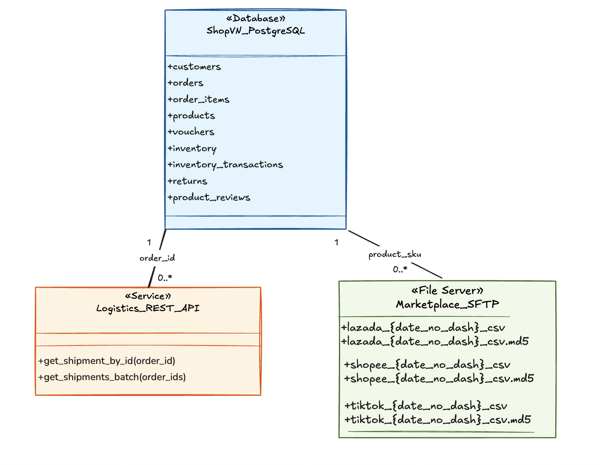
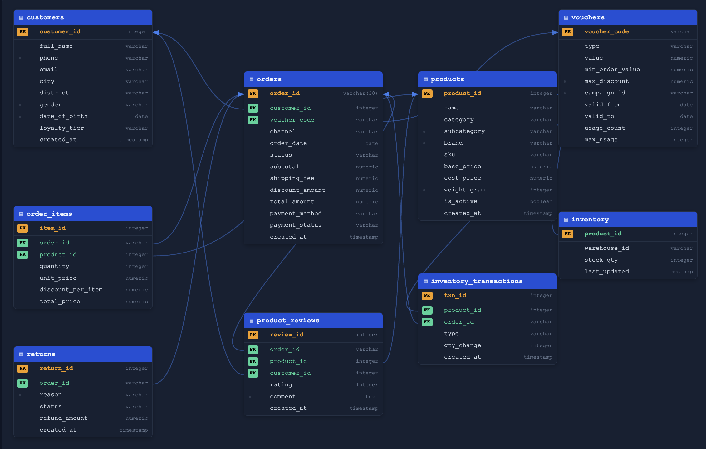

# ShopVN Dataset Guide

**Course**: Master Class DataOps for Modern Data Platforms
**Version**: 1.0

This document covers everything you need to know about the ShopVN dataset: what data is available, how the schemas are structured, how the three sources relate to each other, and how to get the environment running on your local machine.

---

## 1. Business Context

ShopVN is a Vietnamese e-commerce platform operating across two sales channels:

- **Direct channel** (70% of orders): customers buy directly via ShopVN's web and app
- **Marketplace channel** (30% of orders): customers buy through Lazada, Shopee, or TikTok

The dataset covers **30 days of transactions** from `2026-06-01` to `2026-06-30`, including two flash sale events on June 7 and June 15 that generate 2.5–3× the normal daily volume.

---

## 2. Three Data Sources


### Source 1 — PostgreSQL (OLTP Database)

The core transactional system for direct-channel orders. This is the **system of record** for customers, products, inventory, orders, and vouchers.

**Connection**:
```
Host:     localhost  |  Port: 5434
Database: shopvn
User:     shopvn_reader  (SELECT only)
Password: readonly123
```

### Source 2 — REST API (Logistics)

Provides shipment tracking data from GHN and GHTK carriers. This is the **only source** for: carrier identity, actual delivery dates, delivery attempts, failure reasons, and recipient province/district.

**Connection**:
```
Base URL: http://localhost:8000
Header:   X-API-Key: shopvn-logistics-key-2026
```

**Endpoints**:
```
GET /health
GET /v1/shipments/{order_id}
GET /v1/shipments?order_ids=id1,id2,...   (max 50 per request)
```

### Source 3 — SFTP (Marketplace Files)

**What is SFTP?**
SFTP (SSH File Transfer Protocol) is a secure file transfer protocol built on top of SSH. Unlike FTP, all data is encrypted in transit. In real-world data pipelines, SFTP is commonly used by partners (e.g. e-commerce marketplaces, banks, logistics providers) to deliver daily batch export files — typically CSVs — to your ingestion layer. Your pipeline connects to the SFTP server, lists available files, downloads them, validates integrity (checksum), then processes the data.

Daily sales export files from Lazada, Shopee, and TikTok. Each file covers one partner for one day. This is the **only source** for marketplace-channel revenue, platform commissions, and platform discounts.

**Connection**:
```
Host:     localhost  |  Port: 2222
User:     marketplace_reader
Password: sftp_readonly_2026
Path:     /marketplace/incoming/
```

---

## 3. PostgreSQL Schema

### 3.1 Entity Relationship Overview


### 3.2 Table Definitions

#### `customers`

Stores all registered customers. PII fields are present in source — must be masked before loading to analytics.

| Column | Type | Notes |
|--------|------|-------|
| `customer_id` | SERIAL PK | |
| `full_name` | VARCHAR | PII |
| `phone` | VARCHAR | PII — **~0.6% NULL** (intentional) |
| `email` | VARCHAR | PII |
| `city` | VARCHAR | |
| `district` | VARCHAR | |
| `ward` | VARCHAR | |
| `gender` | VARCHAR | male / female / other |
| `date_of_birth` | DATE | |
| `loyalty_tier` | VARCHAR | bronze / silver / gold / platinum |
| `created_at` | TIMESTAMP | |

**Row count**: ~50,000

**Loyalty tier distribution**: bronze 60% · silver 25% · gold 12% · platinum 3%

---

#### `products`

Product catalog for ShopVN's direct channel.

| Column | Type | Notes |
|--------|------|-------|
| `product_id` | SERIAL PK | also JOIN KEY for SFTP |
| `name` | VARCHAR | |
| `category` | VARCHAR | 8 categories |
| `subcategory` | VARCHAR | brand name |
| `brand` | VARCHAR | |
| `sku` | VARCHAR UNIQUE | |
| `base_price` | DECIMAL | selling price |
| `cost_price` | DECIMAL | **~50 rows: cost > base** (intentional) |
| `weight_gram` | INT | |
| `is_active` | BOOLEAN | ~2% inactive |
| `created_at` | TIMESTAMP | |

**Row count**: 2,000
**Categories**: Điện thoại · Laptop · Thời trang · Gia dụng · Mỹ phẩm · Thực phẩm · Đồ chơi · Sách

---

#### `orders`

Central fact table. One row per order from the direct channel.

| Column | Type | Notes |
|--------|------|-------|
| `order_id` | VARCHAR PK | Format: `ORD-YYYYMMDD-XXXXX` — also API JOIN KEY |
| `customer_id` | INT FK → customers | |
| `voucher_code` | VARCHAR FK → vouchers | **nullable** — 70% of orders have no voucher |
| `channel` | VARCHAR | web / app |
| `order_date` | DATE | |
| `status` | VARCHAR | delivered / shipping / confirmed / cancelled / returned |
| `subtotal` | DECIMAL | sum of order_items |
| `shipping_fee` | DECIMAL | **~2% = 0** (intentional — no freeship voucher) |
| `discount_amount` | DECIMAL | **~0.3% > subtotal** (intentional — flash sale bug) |
| `total_amount` | DECIMAL | subtotal + shipping_fee − discount_amount |
| `payment_method` | VARCHAR | cod / momo / banking / card |
| `payment_status` | VARCHAR | pending / paid / failed / refunded |
| `created_at` | TIMESTAMP | |

**Row count**: ~210,000
**Status distribution**: delivered 65% · shipping 15% · confirmed 10% · cancelled 8% · returned 2%
**Payment method**: cod 40% · momo 25% · banking 20% · card 15%

---

#### `order_items`

Line items for each order. One row per product per order.

| Column | Type | Notes |
|--------|------|-------|
| `item_id` | SERIAL PK | |
| `order_id` | VARCHAR FK → orders | |
| `product_id` | INT FK → products | |
| `quantity` | INT | **~1% = 0** (intentional — legacy edge case) |
| `unit_price` | DECIMAL | price at time of order |
| `discount_per_item` | DECIMAL | flash sale item-level discount |
| `total_price` | DECIMAL | (unit_price − discount_per_item) × quantity |

**Row count**: ~440,000

---

#### `vouchers`

Discount codes used in orders.

| Column | Type | Notes |
|--------|------|-------|
| `voucher_code` | VARCHAR PK | |
| `type` | VARCHAR | value / percent |
| `value` | DECIMAL | amount or percentage |
| `min_order_value` | DECIMAL | minimum order to apply |
| `max_discount` | DECIMAL | cap for percent-type vouchers |
| `campaign_id` | VARCHAR | BIRTHDAY / SUMMER2026 / WEEKEND / NEWUSER / FLASHSALE / LOYALTY |
| `valid_from` | DATE | |
| `valid_to` | DATE | |
| `usage_count` | INT | |
| `max_usage` | INT | |

**Row count**: 200

---

#### `inventory`

Current stock level per product. 1:1 with `products`.

| Column | Type | Notes |
|--------|------|-------|
| `product_id` | INT PK FK → products | |
| `warehouse_id` | VARCHAR | |
| `stock_qty` | INT | current quantity — reconstruct history from `inventory_transactions` |
| `last_updated` | TIMESTAMP | |

**Row count**: 2,000

---

#### `inventory_transactions`

Audit log of every stock movement. Use this to reconstruct end-of-day inventory for any past date.

| Column | Type | Notes |
|--------|------|-------|
| `txn_id` | SERIAL PK | |
| `product_id` | INT FK → products | |
| `order_id` | VARCHAR FK → orders | nullable |
| `type` | VARCHAR | reserve / release / sold / restock |
| `qty_change` | INT | negative = stock decrease |
| `created_at` | TIMESTAMP | |

**Row count**: ~427,000

---

#### `returns`

Return requests for delivered orders.

| Column | Type | Notes |
|--------|------|-------|
| `return_id` | SERIAL PK | |
| `order_id` | VARCHAR FK → orders | |
| `reason` | VARCHAR | |
| `status` | VARCHAR | pending / approved / rejected / refunded |
| `refund_amount` | DECIMAL | |
| `created_at` | TIMESTAMP | |

**Row count**: ~4,300

---

#### `product_reviews`

Customer reviews submitted after delivery.

| Column | Type | Notes |
|--------|------|-------|
| `review_id` | SERIAL PK | |
| `order_id` | VARCHAR FK → orders | |
| `product_id` | INT FK → products | |
| `customer_id` | INT FK → customers | |
| `rating` | INT | 1–5 |
| `comment` | TEXT | nullable — ~40% of reviews are rating-only |
| `created_at` | TIMESTAMP | |

**Row count**: ~41,000

---

### 3.3 Cross-Source Relationships

```
PostgreSQL.orders.order_id
    └── API.shipments.order_id          (LEFT JOIN — ~8% will have no shipment)

PostgreSQL.products.product_id
    └── SFTP.shopvn_product_id          (LEFT JOIN — product-level only)
```

**Important**: `SFTP.external_order_id` (e.g. `LAZADA-20260601-000001`) has **no relationship** to `PostgreSQL.orders.order_id` (e.g. `ORD-20260601-00001`). These are two completely separate order systems. You can only join at the product level.

---

## 4. REST API Schema

### 4.1 Shipment Response

```json
{
  "order_id":                "ORD-20260601-00001",
  "carrier":                 "ghn",
  "tracking_code":           "GHN202676602",
  "status":                  "delivered",
  "actual_shipping_fee":     20000,
  "shipped_at":              "2026-06-01T18:00:00+07:00",
  "actual_delivery_date":    "2026-06-02T10:26:00+07:00",
  "estimated_delivery_date": "2026-06-03",
  "recipient_province":      "Hà Nội",
  "recipient_district":      "Đống Đa",
  "delivery_attempts":       1,
  "failure_reason":          null
}
```

**Status values**: `picked_up` · `in_transit` · `delivered` · `failed` · `returned`
**Failure reasons** (when status = failed): `not_at_home` · `wrong_address` · `refused` · `phone_off` · `cannot_locate`
**Carriers**: `ghn` · `ghtk`

### 4.2 Batch Response

```json
{
  "shipments": [ { ... }, { ... } ],
  "count": 42,
  "not_found": ["ORD-20260601-00010", "ORD-20260601-00050"],
  "not_found_count": 2
}
```

### 4.3 Error Responses

| HTTP | Error key | When |
|------|-----------|------|
| 401 | `invalid_api_key` | Missing or wrong API key |
| 400 | `batch_size_exceeded` | >50 order IDs in one request |
| 404 | `shipment_not_found` | Order cancelled or 404-injection (~8%) |
| 429 | `rate_limit_exceeded` | >100 requests/minute — includes `retry_after` seconds |
| 500 | `internal_server_error` | Random 1% failure injection |

---

## 5. SFTP File Schema

### 5.1 Directory Structure

```
/marketplace/incoming/
├── lazada/
│   ├── lazada_20260601.csv
│   ├── lazada_20260601.csv.md5
│   ├── lazada_20260602.csv
│   ├── lazada_20260602.csv.md5
│   └── ... (up to 30 days)
├── shopee/   (same structure)
└── tiktok/   (same structure)
```

Total: up to 90 CSV + 90 MD5 = 180 files. In practice 3 days × 1 partner file will be missing.

### 5.2 CSV Columns

| Column | Type | Description |
|--------|------|-------------|
| `external_order_id` | string | Order ID on the platform (e.g. `LAZADA-20260601-000001`) |
| `shopvn_product_id` | int | **JOIN KEY** → `products.product_id` |
| `seller_sku` | string | SKU as listed on the platform |
| `partner` | string | lazada / shopee / tiktok |
| `order_date` | YYYY-MM-DD | |
| `quantity_sold` | int | |
| `sale_price` | int (VND) | after platform discount |
| `platform_discount` | int (VND) | discount applied by platform (not by ShopVN) |
| `commission_rate` | decimal | e.g. 0.08 = 8% |
| `net_revenue` | int (VND) | = sale_price × quantity × (1 − commission_rate) |
| `settlement_date` | YYYY-MM-DD | = order_date + 15 days (T+15 payment cycle) |
| `status` | string | completed / returned / disputed |

### 5.3 File Sizes

| Partner | Normal day | Flash sale (Jun 7 & 15) |
|---------|-----------|------------------------|
| Lazada | 200–400 KB | 8–12 MB |
| Shopee | 350–600 KB | 12–18 MB |
| TikTok | 150–300 KB | 6–10 MB |

### 5.4 Checksum Files

Every CSV has a companion `.md5` file containing the MD5 hash of the CSV. You must verify this before processing:

```python
import hashlib

def verify_checksum(csv_path: str, md5_path: str) -> bool:
    with open(md5_path) as f:
        expected = f.read().strip()
    md5 = hashlib.md5()
    with open(csv_path, "rb") as f:
        for chunk in iter(lambda: f.read(8192), b""):
            md5.update(chunk)
    return md5.hexdigest() == expected
```

---

## 6. Intentional Failures

All failures listed below are **by design**.

### 6.1 PostgreSQL — Data Quality Issues

| Issue | Column | Rate | Your pipeline must | Why |
|-------|--------|------|--------------------|-----|
| NULL phone number | `customers.phone` | ~0.6% | Handle nullable, do not crash | Valid — some customers don't provide a phone number. Crash here means your entire pipeline stops for a minority edge case. |
| Zero shipping fee | `orders.shipping_fee` | ~2% | Flag as anomaly, continue | No freeship voucher was applied, yet fee = 0. Order is valid — do not reject. Flag so analytics team can investigate. |
| Discount > subtotal | `orders.discount_amount` | ~0.3% | Cap or flag, document decision | If loaded as-is, `total_amount = subtotal − discount` goes negative. Revenue cannot be negative. Choose: cap discount at subtotal, or flag row. Either is valid — **document your decision**. |
| Zero quantity | `order_items.quantity` | ~1% | Flag or filter, document decision | `total_price = unit_price × 0 = 0`. Row contributes nothing to revenue but would corrupt "units sold" metrics. Choose: filter it out, or keep and exclude from quantity aggregations. **Document your decision**. |
| Cost > base price | `products.cost_price` | 50 rows | Flag as loss-making product | Not a pipeline error — a business insight. These products are being sold at a loss. Load normally, but add a `is_loss_making` flag so Finance/Product teams can act on it. |

### 6.2 REST API — Injected Failures

| Failure | Rate | Your pipeline must |
|---------|------|--------------------|
| Rate limit (HTTP 429) | >100 req/min | Wait `retry_after` seconds, retry |
| Timeout (35s sleep) | 5% of requests | Retry 3× with backoff: 1s → 2s → 4s |
| Not found (HTTP 404) | ~8% of order IDs | Skip and log — deterministic per order_id |
| Server error (HTTP 500) | 1% | Retry once, then skip |
| Batch too large (HTTP 400) | >50 IDs | Fix your chunking (client bug) |

> The 404 injection is **deterministic** — the same `order_id` always returns the same result. This makes failures reproducible for debugging.

### 6.3 SFTP — File Failures

| Failure | Count | Your pipeline must |
|---------|-------|--------------------|
| Missing file | 3 days × 1 partner | Detect on listing, log warning, continue |
| Corrupt file | 2 days × 1 partner | Checksum fails → reject + alert |
| Late arrival | 2 days × 1 partner | ⚠️ See note below |

> **Note on Late Arrival**: All SFTP files in this environment are pre-generated and available immediately when the container starts — there is no actual delay. The `LATE` entries in `FAILURE_MANIFEST.txt` are **conceptual markers** that represent a real-world scenario your pipeline code must be designed to handle, but you cannot test it live with this setup. To test late arrival handling, manually rename or remove a file from the SFTP directory, then copy it back later to simulate the file arriving after your pipeline's initial run.

Check `/marketplace/incoming/FAILURE_MANIFEST.txt` for the exact days and partners.

---

## 7. Data Volume Summary

| Table / Source | Rows | Notes |
|----------------|------|-------|
| `customers` | 50,000 | ~290 with NULL phone |
| `products` | 2,000 | 50 with cost > base |
| `inventory` | 2,000 | current state only |
| `vouchers` | 200 | 6 campaigns |
| `orders` | ~210,000 | 30 days, direct channel only |
| `order_items` | ~440,000 | |
| `returns` | ~4,300 | ~2% of delivered orders |
| `product_reviews` | ~41,000 | ~30% of delivered orders |
| `inventory_transactions` | ~427,000 | full audit log |
| API shipments | ~192,000 | ~92% of non-cancelled orders |
| SFTP CSV files | 87 files | 90 − 3 missing = 87 |
| SFTP total rows | ~200,000 | marketplace orders, 30 days × 3 partners |

---

## 8. Setup & Installation

### 8.1 Prerequisites

| Tool | Version |
|------|---------|
| Docker | 24+ |
| Docker Compose | v2 |
| RAM available for Docker | ≥ 4 GB |
| Free disk space | ≥ 3 GB |

### 8.2 Start the Environment

```bash
# Clone or copy the shopvn-datasource directory
cd shopvn-datasource

# Pull pre-built images from Docker Hub and start all services
docker compose up -d

# Check that all three containers are running
docker compose ps
```

Expected output:
```
NAME                           STATUS           PORTS
masterclass-dataops-api        Up               0.0.0.0:8000->8000/tcp
masterclass-dataops-postgres   Up (healthy)     0.0.0.0:5434->5432/tcp
masterclass-dataops-sftp       Up               0.0.0.0:2222->22/tcp
```

> PostgreSQL restores ~200,000 rows from a pre-built dump on first start. This takes about **60 seconds**. The container will show `(healthy)` once it is ready.

### 8.3 Verify Each Source

```bash
# PostgreSQL — total order count
psql -h localhost -p 5434 -U shopvn_reader -d shopvn \
  -c "SELECT COUNT(*) FROM orders;"
# Expected: ~210,000

# Flash sale volume check
psql -h localhost -p 5434 -U shopvn_reader -d shopvn \
  -c "SELECT order_date, COUNT(*) FROM orders
      WHERE order_date IN ('2026-06-01','2026-06-07')
      GROUP BY order_date;"
# Expected: ~5,000-7,000 on Jun 1 vs ~15,000-18,000 on Jun 7

# API health
curl http://localhost:8000/health
# Expected: {"status":"ok","timestamp":"..."}

# API single shipment
curl -H "X-API-Key: shopvn-logistics-key-2026" \
  "http://localhost:8000/v1/shipments/ORD-20260601-00001"
# Expected: JSON with carrier, status, delivery dates

# SFTP — list files
sftp -P 2222 marketplace_reader@localhost
sftp> ls /marketplace/incoming/lazada/
# Expected: ~27-29 CSV files (not 30 — some are intentionally missing)
sftp> get /marketplace/incoming/FAILURE_MANIFEST.txt .
sftp> exit
cat FAILURE_MANIFEST.txt
# Shows exactly which days/partners have failures
```

### 8.4 Stop and Reset

```bash
# Stop services (keep data)
docker compose stop

# Stop and remove containers (keep data volumes)
docker compose down

# Full reset — delete all data and start fresh
docker compose down && docker compose up -d
# Note: PostgreSQL will re-initialize from dump (~60 seconds)
```

### 8.5 Docker Images

All images are published on Docker Hub under `anhnguyen1611/`:

| Image | Description |
|-------|-------------|
| `anhnguyen1611/masterclass-dataops-postgres:latest` | PostgreSQL 16 with pre-seeded ShopVN data |
| `anhnguyen1611/masterclass-dataops-api:latest` | FastAPI logistics service |
| `anhnguyen1611/masterclass-dataops-sftp:latest` | SFTP server with marketplace files baked in |

---

## 9. What Only Lives in Each Source

This is a critical point for pipeline design. Use the right source for the right question.

| Data | PostgreSQL | API | SFTP |
|------|-----------|-----|------|
| Order revenue (direct) | ✅ | ❌ | ❌ |
| Customer demographics | ✅ | ❌ | ❌ |
| Product catalog | ✅ | ❌ | ❌ |
| Voucher / campaign data | ✅ | ❌ | ❌ |
| Return / refund history | ✅ | ❌ | ❌ |
| **Carrier (GHN vs GHTK)** | ❌ | ✅ | ❌ |
| **Actual delivery date** | ❌ | ✅ | ❌ |
| **Delivery attempts** | ❌ | ✅ | ❌ |
| **Failure reason** | ❌ | ✅ | ❌ |
| **Recipient province** | ❌ | ✅ | ❌ |
| **Marketplace revenue** | ❌ | ❌ | ✅ |
| **Commission cost** | ❌ | ❌ | ✅ |
| **Platform discount** | ❌ | ❌ | ✅ |
| **Settlement date (T+15)** | ❌ | ❌ | ✅ |

---

## 10. Key Business Rules

### Revenue Calculation

```
Direct channel order:
  total_amount = subtotal + shipping_fee − discount_amount

Marketplace net revenue (per row in SFTP):
  net_revenue = sale_price × quantity_sold × (1 − commission_rate)
```

### Settlement Lag

Marketplace platforms pay on a T+15 cycle:
```
settlement_date = order_date + 15 days
```

Revenue is **earned** on `order_date` but **received** on `settlement_date`. Your data model must account for this distinction when answering Finance team questions.

### Inventory Reconstruction

The `inventory` table only stores the **current** stock level. To get end-of-day stock for a past date, reconstruct it from `inventory_transactions`:

```sql
-- Stock at end of 2026-06-15 for a given product
SELECT
  stock_qty
  - COALESCE(SUM(qty_change) FILTER (WHERE created_at > '2026-06-15 23:59:59'), 0)
  AS stock_on_2026_06_15
FROM inventory
LEFT JOIN inventory_transactions USING (product_id)
WHERE product_id = 123
GROUP BY stock_qty;
```

### Loyalty Tier History

The `customers` table only stores the **current** loyalty tier. Historical changes cannot be backfilled. SCD Type 2 tracking of tier changes is only possible from the day your pipeline starts running.
